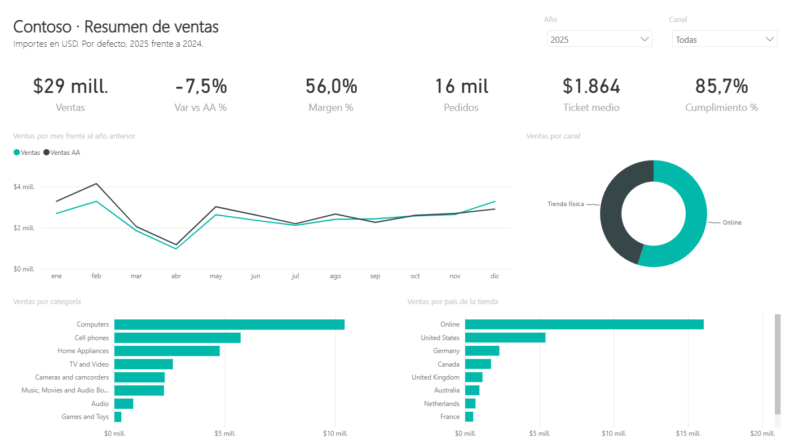
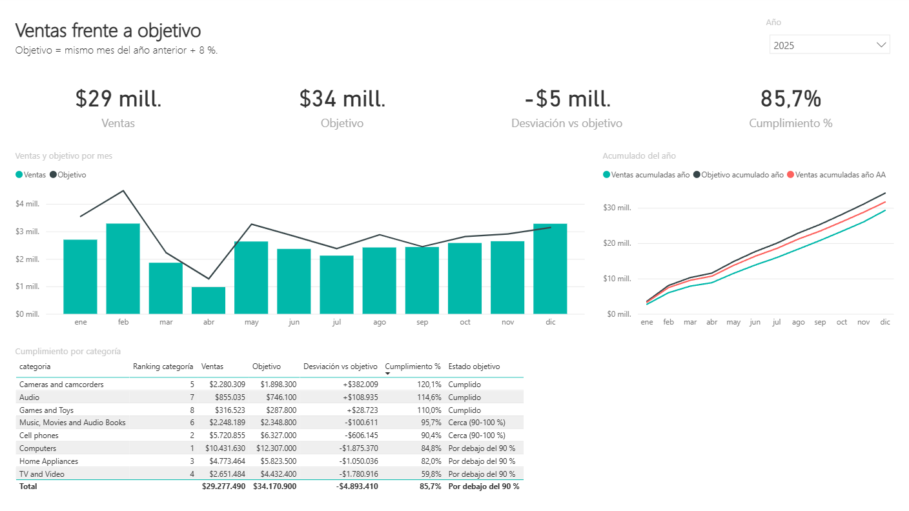
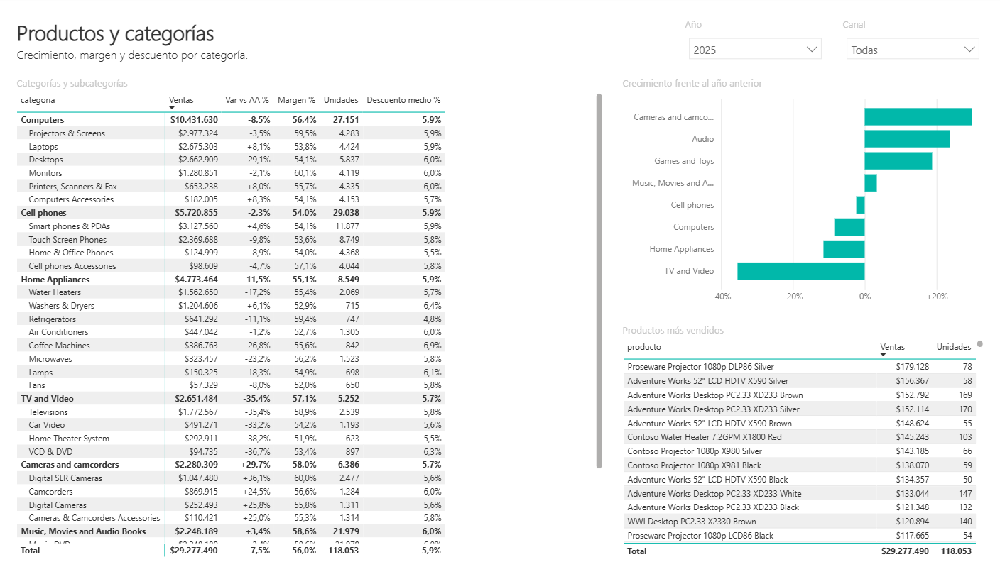
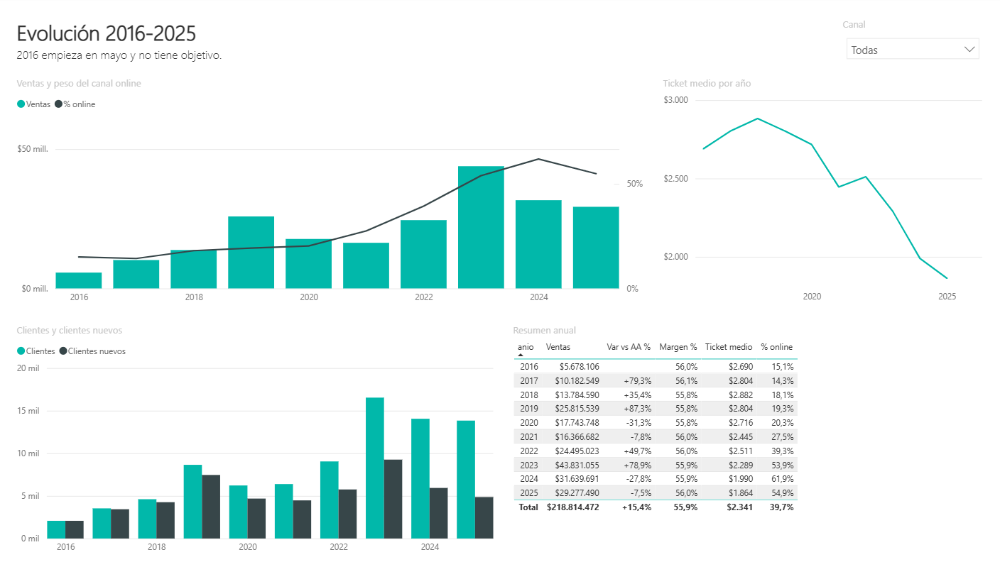
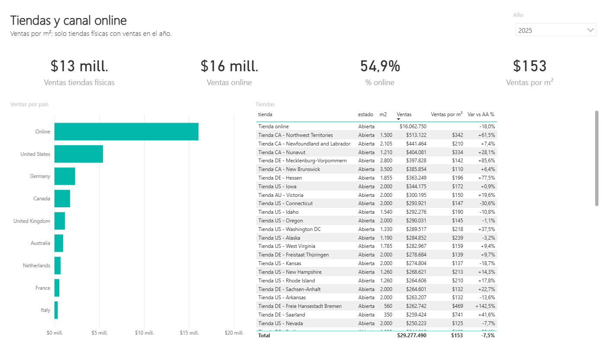

# Contoso Retail — dashboard de ventas en Power BI

**Informe de Power BI de 5 páginas sobre 224.000 líneas de venta de una cadena de electrónica con tiendas en 8 países y tienda online (2016-2025).**

[](https://github.com/alvarodc093-pixel/Contoso-Retail-PowerBI/actions/workflows/ci.yml)    



## En resumen

- **Problema:** la dirección de una cadena de tiendas necesita saber cómo van las ventas frente al año anterior y frente al presupuesto, qué categorías y tiendas tiran o frenan, y cuánto pesa ya el canal online.
- **Datos:** [Contoso V2](https://github.com/sql-bi/Contoso-Data-Generator-V2-Data) de SQLBI, el dataset de ventas de referencia para Power BI (licencia MIT). Uso la versión de 100.000 pedidos: 223.974 líneas de venta, 2.517 productos, 74 tiendas y 52.189 clientes.
- **Power BI:** modelo en estrella con 7 tablas, **28 medidas DAX** (inteligencia de tiempo, objetivos, clientes nuevos, rankings, ventas por m²), Power Query y 5 páginas de informe.
- **Resultado:** en 2025 la cadena vende **29,3 M$**, un **7,5 % menos** que en 2024, y se queda en el **85,7 % del objetivo**. El margen se mantiene en el 56 %, pero el ticket medio lleva 7 años bajando, y la tienda online ya vende más que todas las tiendas físicas juntas.

## Hallazgos principales

| # | Pregunta | Respuesta | Página |
|---|---|---|---|
| 1 | ¿Cómo va el año? | 29,3 M$ en 2025: **-7,5 %** frente a 2024 y -33 % frente al pico de 2023 (43,8 M$). | Resumen |
| 2 | ¿Cumplimos el presupuesto? | **85,7 %**: faltan 4,9 M$. Solo 3 de 8 categorías cumplen: cámaras (120 %), audio (115 %) y juegos (110 %). Televisión y vídeo se queda en el **60 %**. | Objetivos |
| 3 | ¿Qué categorías tiran y cuáles frenan? | Ordenadores es el 36 % de las ventas y cae un 8,5 %. Televisión y vídeo cae un **35 %**. Cámaras crece un **30 %**. | Productos |
| 4 | ¿Cuánto pesa el online? | Pasa del 15 % de las ventas en 2016 al **62 % en 2024** y al 55 % en 2025. En 2025 la tienda online sola (16,1 M$) vende más que todas las tiendas físicas juntas (13,2 M$). | Evolución, Tiendas |
| 5 | ¿Por qué bajan las ventas si se mantiene el margen? | Porque cada pedido es más pequeño: el **ticket medio baja de 2.882 $ (2018) a 1.864 $ (2025)**, un -35 %. El margen (56 %) y el descuento medio (6 %) apenas cambian. | Evolución |
| 6 | ¿Llegan clientes nuevos? | 4.865 en 2025, el 35 % de los clientes del año, frente a los 9.257 de 2023. | Evolución |



## Recomendaciones de negocio

1. **Investigar el ticket medio.** Es la palanca que explica la caída: hay que ver si los pedidos llevan menos unidades o productos más baratos, y probar packs o venta cruzada en ordenadores, la categoría más grande.
2. **Revisar televisión y vídeo.** Cae un 35 % y cumple el 60 % del objetivo. O se reduce su presupuesto o hace falta un plan de surtido y precio.
3. **Apoyarse en lo que crece.** Cámaras, audio y juegos superan su objetivo: merecen más espacio y más promoción.
4. **Revisar la red de tiendas.** El online ya vende más que todas las tiendas físicas juntas. Las que menos venden por m² son candidatas a reformarse o a convertirse en puntos de recogida.
5. **Recuperar la captación.** Los clientes nuevos han bajado casi a la mitad desde 2023.

## Las 5 páginas

| Página | Qué responde | Elementos |
|---|---|---|
| **Resumen** | ¿Cómo va el año? | 6 KPIs, ventas por mes frente al año anterior, ventas por canal, categoría y país. Filtros de año y canal. |
| **Productos** | ¿Qué se vende y con qué margen? | Matriz de categoría y subcategoría (ventas, crecimiento, margen, unidades, descuento), crecimiento por categoría y productos más vendidos. |
| **Evolución** | ¿Hacia dónde vamos? | Ventas y peso del online por año, ticket medio, clientes y clientes nuevos, tabla resumen 2016-2025. |
| **Tiendas** | ¿Qué tiendas rinden? | Ventas físicas frente a online, ventas por m², ranking de tiendas con crecimiento. |
| **Objetivos** | ¿Cumplimos el presupuesto? | Ventas frente a objetivo por mes, acumulado del año frente a objetivo y año anterior, cumplimiento por categoría con semáforo. |

| Productos | Evolución | Tiendas |
|---|---|---|
|  |  |  |

## El modelo de datos

```text
                 calendario (1 fila por día)
                   ▲                 ▲
                   │                 │
   productos ──► ventas ◄── tiendas  objetivos (mes x categoría)
       │           ▲                 │
       ▼           │                 │
   categorias ◄────┼─────────────────┘
                 clientes
```

- **ventas** es la tabla de hechos: una fila por línea de pedido.
- **objetivos** tiene otro nivel de detalle (mes y categoría, no producto ni día). Por eso las categorías están en su propia tabla `categorias`, que filtra a la vez a `productos` (y de ahí a `ventas`) y a `objetivos`. Así ventas y objetivo se comparan en el mismo visual sin relaciones de muchos a muchos.
- **calendario** está marcado como tabla de fechas, con los meses en español ordenados por número.
- Todas las relaciones son de muchos a uno y filtran en una sola dirección.

### Medidas DAX destacadas

Las 28 medidas, con su código, están en [docs/medidas_dax.md](docs/medidas_dax.md). Algunas:

```dax
Var vs AA % = DIVIDE ( [Var vs AA], [Ventas AA] )
-- Ventas AA = CALCULATE ( [Ventas], SAMEPERIODLASTYEAR ( calendario[fecha] ) )

Clientes nuevos =
VAR inicio = MIN ( calendario[fecha] )
VAR fin = MAX ( calendario[fecha] )
VAR primeras =
    ADDCOLUMNS (
        VALUES ( ventas[cliente_id] ),
        "@primera", CALCULATE ( MIN ( ventas[fecha] ), REMOVEFILTERS ( calendario ) )
    )
RETURN
    COUNTROWS ( FILTER ( primeras, [@primera] >= inicio && [@primera] <= fin ) )

Ventas por m² =
VAR tiendasConVentas =
    FILTER ( VALUES ( tiendas[tienda_id] ), [Ventas tiendas físicas] > 0 )
VAR superficie =
    SUMX ( tiendasConVentas, CALCULATE ( SUM ( tiendas[m2] ) ) )
RETURN
    DIVIDE ( [Ventas tiendas físicas], superficie )
```

### Decisiones

- **Todo en USD.** Contoso guarda el precio en dólares en todos los pedidos; el tipo de cambio solo sirve para pasar a la moneda del cliente. Si se multiplica por él, se mezclan monedas.
- **El objetivo lo construyo yo,** porque Contoso no trae presupuesto: es lo vendido el mismo mes del año anterior, por categoría, más un 8 %. Es la regla más habitual en un presupuesto de ventas sencillo y deja claro de dónde sale cada número.
- **Clientes sin datos personales.** De la tabla de clientes solo uso país, continente, género y grupo de edad.
- **Ventas por m²** solo cuenta las tiendas físicas que han vendido en el periodo, para que las tiendas cerradas no rebajen la media.

## Cómo está montado

El informe está guardado en formato **PBIP** (proyecto de Power BI): el modelo en TMDL y el informe en PBIR, todo en texto. Eso permite versionarlo con Git, revisar los cambios y testearlo.

```text
.
├── powerbi/
│   ├── ContosoRetail.pbip              # se abre con Power BI Desktop
│   ├── ContosoRetail.SemanticModel/    # modelo: tablas, relaciones y medidas (TMDL)
│   ├── ContosoRetail.Report/           # informe: páginas y visuales (PBIR)
│   └── datos/                          # las 7 tablas en CSV + cifras_control.json
├── descargar_datos.py                  # baja Contoso V2 de SQLBI
├── preparar_datos.py                   # SQL (DuckDB): esquema en estrella, calendario y objetivos
├── modelo.py                           # definición del modelo y de las 28 medidas DAX
├── informe.py                          # definición de las 5 páginas
├── generar_pbip.py                     # escribe powerbi/ y docs/medidas_dax.md
├── verificar_dax.ps1                   # compara las medidas DAX con las cifras de SQL
├── tests/                              # 48 tests
└── docs/                               # capturas y documentación de las medidas
```

### Cómo sé que las cifras son correctas

1. `preparar_datos.py` calcula con SQL los totales de cada año (ventas, margen, pedidos, clientes, % online y objetivo) y los guarda en `cifras_control.json`.
2. Con el informe abierto en Power BI Desktop, `verificar_dax.ps1` lanza una consulta DAX contra el modelo y compara: **las medidas DAX coinciden con SQL en los 10 años**.
3. Los tests comprueban, sin abrir Power BI, que:
   - cada medida usa columnas y medidas que existen;
   - las relaciones van a una clave;
   - los visuales usan campos reales y caben en el lienzo;
   - la preparación de datos da lo esperado en un mini dataset hecho a mano.
   - Los JSON del informe además se validaron contra los esquemas oficiales de Microsoft.

## Cómo abrirlo

1. Descarga o clona el repositorio y abre `powerbi/ContosoRetail.pbip` con [Power BI Desktop](https://powerbi.microsoft.com/desktop/) (gratis).
2. Pulsa **Actualizar**. Los datos se leen de este repositorio en GitHub; no hace falta descargar nada más.

Para regenerar todo desde el dataset original:

```bash
pip install -r requirements.txt
python descargar_datos.py     # ~10 MB desde SQLBI
python preparar_datos.py      # escribe powerbi/datos/
python generar_pbip.py        # escribe powerbi/ (con --local, lee los CSV del disco)
pytest -q
```

## Limitaciones

- Contoso es un dataset **sintético**, pensado para practicar análisis y Power BI. Las tendencias son realistas, pero no son de una empresa real.
- 2016 empieza en mayo, así que su crecimiento y el objetivo de 2017 no son comparables con el resto.
- El objetivo es una regla sencilla (año anterior + 8 %). Un presupuesto real tendría en cuenta aperturas, cierres y campañas.

## English summary

Five-page Power BI report on 224k sales lines from Contoso V2 (SQLBI, MIT licence), saved as a PBIP project (TMDL and PBIR) so that it can be versioned and tested. It includes a star schema with 7 tables, 28 DAX measures (time intelligence, budget vs actual, new customers, RANKX, sales per m²) and Power Query. The data is prepared with SQL in DuckDB, and the budget is last year's sales plus 8 %. Key findings: 2025 sales fall 7.5 % and reach 85.7 % of budget, the average order value is down 35 % since 2018, and the online store now sells more than all physical stores combined. The DAX results match SQL control figures for all 10 years, and 48 tests check the model, the report definition and the data preparation.
